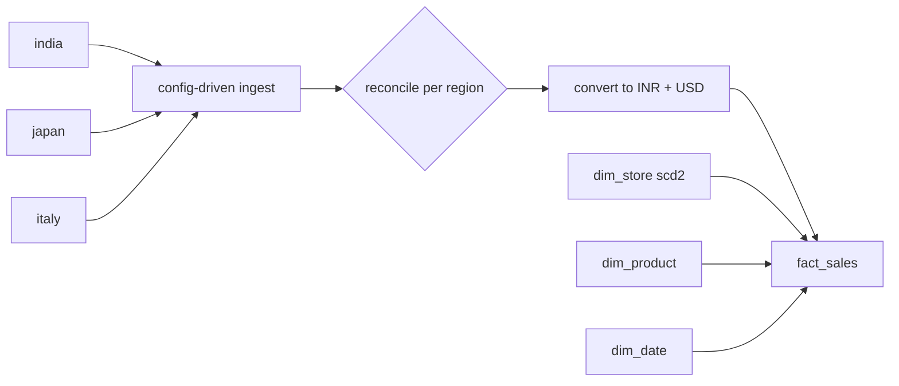

# global-sales-ops-edw

A small enterprise data warehouse that pulls sales from India, Japan and Italy into one star schema, so global numbers come from one place instead of three regional spreadsheets.

At Phantom Hands I worked on centralising regional sales into Microsoft Fabric and onboarding the Japan and Italy teams. This is a simplified rebuild of that idea with **made-up data**. No company code, data or schemas are in here.

## The problem

Every region exports data its own way:

| region | file | format |
|---|---|---|
| India | `india_sales.csv` | INR, `dd-MM-yyyy`, columns like `invoice_no`, `amount_inr` |
| Japan | `japan_sales.csv` | JPY without decimals, `yyyy/MM/dd`, `slip_id`, `shop_cd`, `total_jpy` |
| Italy | `italy_sales.csv` | EUR with a **decimal comma**, `;`-separated, `dd/MM/yyyy`, Italian headers |

Writing custom code for each region doesn't scale, so the region-specific stuff lives in config files instead.

## How it's put together



- `configs/regions/*.json`: one file per region saying which source column is the order id, date, store, product, quantity and amount, plus the date format, delimiter, decimal style and currency. Adding a region is mostly writing one of these ([docs/onboarding_a_new_region.md](docs/onboarding_a_new_region.md)).
- `ingest.py`: reads each source using its config and maps it to a common staging table. Per region, the row counts and local-currency totals have to match the source before the build continues.
- `model.py`:
  - `dim_store` keeps history (SCD Type 2). If a store changes format, older sales stay linked to the old version, so you can compare before and after.
  - monthly FX rates give every line `amount_local`, `amount_inr` and `amount_usd`
  - unknown products/stores map to `-1` instead of disappearing
  - `dim_date` uses the Indian financial year (April–March)
- `sql/`: T-SQL table definitions for a Fabric Warehouse plus a few example queries (sales by region, fulfilment days, category mix).

## Running it

```bash
pip install -r requirements.txt
python scripts/make_sample_data.py --out data/raw
PYTHONPATH=src python -m edw.build --raw data/raw --configs configs/regions --out output/edw
pytest -q
```

## Next steps

- FX uses one monthly rate. Daily rates would be more accurate for bigger amounts.
- `dim_product` is a single global catalogue; real regions often have their own product codes that need a mapping table.
- Returns and inventory aren't in yet. Inventory would be the next fact table.
