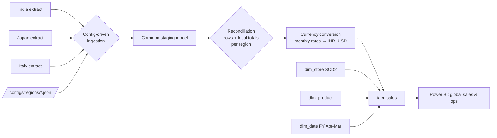

# Global Sales & Operations Centralization EDW

**Inspired by my work at Phantom Hands** · PySpark · config-driven ingestion · dimensional modelling · SCD Type 2 · multi-currency · Microsoft Fabric

A business selling in **India, Japan and Italy** had each region's sales in its own spreadsheet-like extracts: different column names, date formats, decimal separators and currencies. This project centralises them into **one enterprise data warehouse** with one definition of sales and operations metrics, reportable in local currency, **INR and USD**.

> **Independent portfolio project.** It recreates the *kind* of EDW and onboarding framework I built at Phantom Hands, from scratch, with **synthetic data**. It contains no Phantom Hands code, data, schemas or business logic and is not affiliated with Phantom Hands.

---

## The regional sources

| Region | File | Quirks |
|---|---|---|
| 🇮🇳 India | `india_sales.csv` | INR, `dd-MM-yyyy`, `invoice_no / item_code / amount_inr` |
| 🇯🇵 Japan | `japan_sales.csv` | JPY with no decimals, `yyyy/MM/dd`, `slip_id / shop_cd / product_cd / total_jpy` |
| 🇮🇹 Italy | `italy_sales.csv` | EUR with **decimal comma**, **semicolon**-separated, `dd/MM/yyyy`, Italian headers (`ordine, negozio, articolo, importo_eur`) |

## Architecture



## Highlights

- **New region = new config file, not new code.** Each `configs/regions/*.json` maps source columns to the common model and declares the date format, delimiter, decimal style and currency. See [docs/onboarding_a_new_region.md](docs/onboarding_a_new_region.md).
- **Reconciliation gate:** per region, staged row counts and local-currency totals must equal the source before the warehouse is built.
- **Multi-currency:** monthly FX rates give every sale `amount_local`, `amount_inr` and `amount_usd`, and missing rates are flagged.
- **SCD Type 2 stores:** when a store changes format, earlier sales stay with the old version for before-vs-after analysis.
- **Operations metrics:** `fulfilment_days` per order line enables delivery-performance reporting by region and store format.
- **Unknown members (`-1`):** unmatched products or stores are kept and flagged, never dropped.

## Project structure

```
configs/regions/          india.json · japan.json · italy.json  (source-to-target mappings)
scripts/make_sample_data.py
src/edw/ingest.py         config loader + regional parsing into the common model
src/edw/model.py          dim_date, dim_store (SCD2), dim_product, FX conversion, fact_sales
src/edw/build.py          end-to-end build with reconciliation gate
sql/ddl.sql               Fabric Warehouse tables (T-SQL)
sql/analysis_queries.sql  global sales, fulfilment, category mix, SCD2 before/after
tests/                    pytest suite
```

## Run it

```bash
pip install -r requirements.txt
python scripts/make_sample_data.py --out data/raw
PYTHONPATH=src python -m edw.build --raw data/raw --configs configs/regions --out output/edw
pytest -q
```

## On Microsoft Fabric

Regional extracts land in a Lakehouse (`Files/raw/<region>/`) via Data Pipeline Copy activities. `edw.build` runs as a notebook with `--format delta`. The Gold star schema is exposed through the SQL endpoint or loaded into a **Fabric Warehouse** with `sql/ddl.sql`, and a Direct Lake semantic model serves global and regional Power BI reports.

## Tech

Python · PySpark · Spark SQL · T-SQL · Kimball dimensional modelling · SCD Type 2 · config-driven ETL · multi-currency · data reconciliation · Microsoft Fabric · pytest · GitHub Actions
